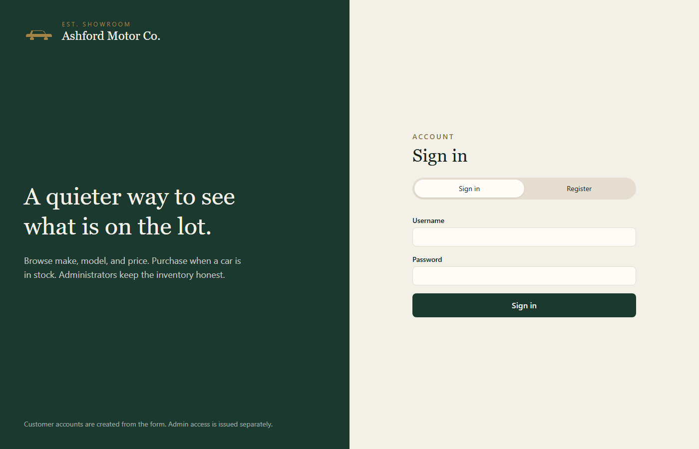
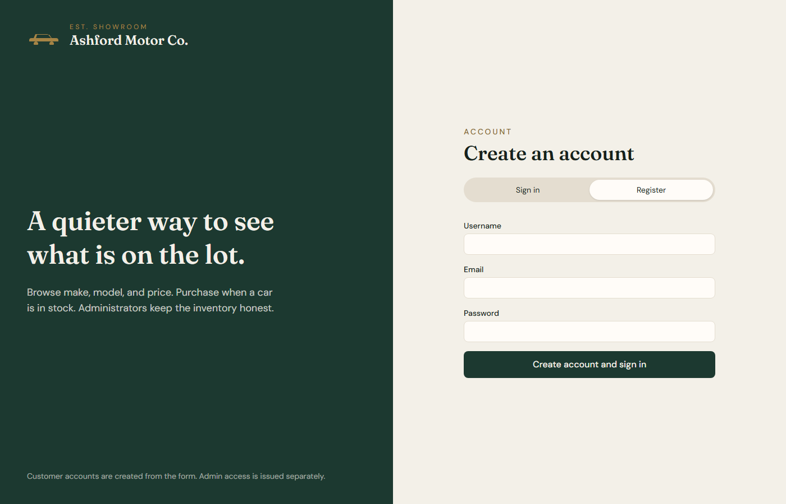
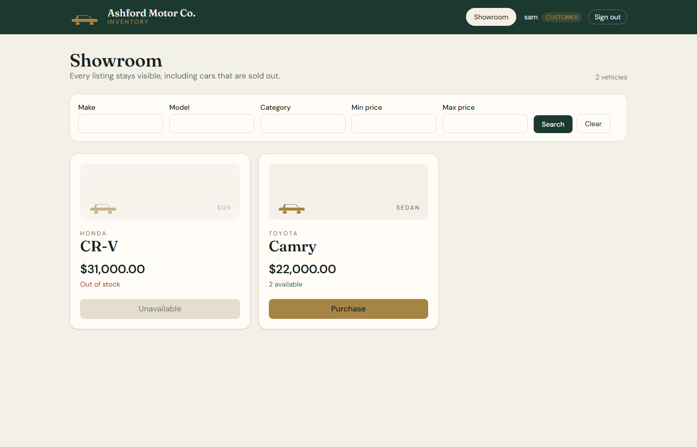
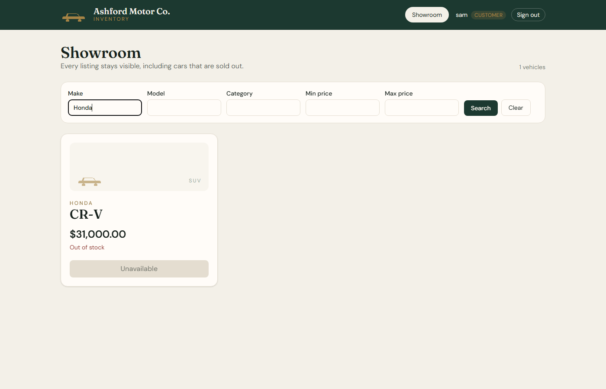
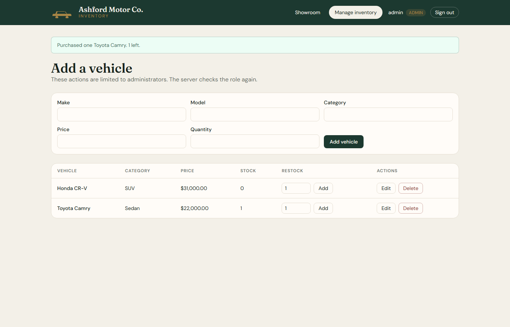

# Ashford Motor Co.

A small car dealership inventory system. Customers register, sign in, search the showroom, and purchase one vehicle at a time. Administrators add, edit, delete, and restock vehicles. The React app talks to a FastAPI backend, and the data is stored in a SQLite file.

## Features

- Customer registration and login
- JWT authentication on inventory routes
- Vehicle list, including cars with zero stock
- Search by make, model, category, and price range
- Purchase one vehicle at a time, with the button disabled at zero stock
- Admin-only create, update, delete, and restock
- Passwords hashed with Argon2
- Stock updates that cannot go below zero, including concurrent purchases

## Technology stack

- Backend: Python, FastAPI, SQLAlchemy, SQLite, PyJWT, Argon2
- Tests: pytest, FastAPI TestClient
- Frontend: React, Vite, JavaScript, HTML5, CSS3, Tailwind CSS
- HTTP client in the browser: Fetch API

## Project structure

```text
car-dealership/
├── backend/
│   ├── main.py              # API routes
│   ├── database.py          # SQLite connection
│   ├── models.py            # User and Vehicle tables
│   ├── schemas.py           # Request validation
│   ├── auth.py              # Passwords and JWT
│   ├── create_admin.py      # Development admin account
│   ├── requirements.txt
│   └── tests/
│       ├── conftest.py
│       └── test_api.py
├── frontend/
│   ├── src/
│   │   ├── App.jsx
│   │   ├── api.js
│   │   ├── main.jsx
│   │   └── index.css
│   ├── package.json
│   └── vite.config.js
├── screenshots/
├── .env.example
├── PROMPTS.md
├── README.md
└── .gitignore
```

## Prerequisites

- Windows 11
- Python 3.11
- Node.js 20 or newer (this project was checked with Node 24)
- PowerShell

The commands below assume the project is at `C:\Users\dhruv\Projects\car-dealership`. Change the path if yours is different.

## Backend installation

```powershell
cd C:\Users\dhruv\Projects\car-dealership\backend
python -m venv .venv
.\.venv\Scripts\Activate.ps1
python -m pip install -r requirements.txt
```

If PowerShell blocks the activate script, run the tools by path instead:

```powershell
.\.venv\Scripts\python.exe -m pip install -r requirements.txt
```

### If pip reports CERTIFICATE_VERIFY_FAILED

The Python install from the Microsoft Store does not ship a CA bundle, so pip cannot verify `pypi.org`. Build a bundle from the Windows certificate store once, then point pip at it:

```powershell
$bundle = Join-Path $env:TEMP "windows-ca-bundle.pem"
Remove-Item $bundle -ErrorAction SilentlyContinue
foreach ($path in @("Cert:\LocalMachine\Root", "Cert:\CurrentUser\Root")) {
  Get-ChildItem $path | ForEach-Object {
    Add-Content $bundle "-----BEGIN CERTIFICATE-----"
    Add-Content $bundle ([Convert]::ToBase64String($_.RawData, "InsertLineBreaks"))
    Add-Content $bundle "-----END CERTIFICATE-----"
  }
}
$env:SSL_CERT_FILE = $bundle
$env:PIP_CERT = $bundle
python -m pip install -r requirements.txt
```

Use the same `SSL_CERT_FILE` value in any later terminal where pip needs it. Installing Python from [python.org](https://www.python.org/downloads/windows/) avoids this step.

## Frontend installation

```powershell
cd C:\Users\dhruv\Projects\car-dealership\frontend
npm install
```

If npm fails with `UNABLE_TO_VERIFY_LEAF_SIGNATURE`, reuse the certificate bundle from the section above:

```powershell
$env:NODE_EXTRA_CA_CERTS = Join-Path $env:TEMP "windows-ca-bundle.pem"
npm install
```

## Database setup

SQLite creates the database file on its own. There is no separate database server to install.

From the `backend` folder, the default file is `backend\dealership.db`. Tables are created when the API starts. The file is listed in `.gitignore` because it contains local development data.

Tests do not use this file. `backend\tests\conftest.py` points `DATABASE_URL` at a temporary database before the app is imported.

## Environment variables

Copy the example file and edit the secret:

```powershell
cd C:\Users\dhruv\Projects\car-dealership\backend
copy ..\.env.example .env
```

`backend\.env` is ignored by git. Replace at least `JWT_SECRET` with a long random string. The values in `.env.example` are placeholders.

| Variable | Purpose | Default |
| --- | --- | --- |
| `JWT_SECRET` | Signs access tokens | A known development string, printed as a warning at startup |
| `JWT_EXPIRE_MINUTES` | Token lifetime | `60` |
| `DATABASE_URL` | SQLAlchemy database URL | `sqlite:///./dealership.db` |
| `CORS_ORIGINS` | Allowed browser origins | `http://localhost:5173,http://127.0.0.1:5173` |
| `ADMIN_USERNAME` | Used only by `create_admin.py` | none |
| `ADMIN_EMAIL` | Used only by `create_admin.py` | none |
| `ADMIN_PASSWORD` | Used only by `create_admin.py` | none |
| `VITE_API_URL` | Optional frontend API base URL | `http://localhost:8000` |

Put `VITE_API_URL` in `frontend\.env` only if the API is not on port 8000. Restart `npm run dev` after changing it.

## Create an administrator

Public registration always creates a **customer**. It ignores any role sent in the request. Create an administrator from the `backend` folder with the virtual environment active:

```powershell
$env:ADMIN_USERNAME = "admin"
$env:ADMIN_EMAIL = "admin@example.com"
$env:ADMIN_PASSWORD = "change-this-password"
python create_admin.py
```

The password must be at least 8 characters. If that username or email already exists, the script stops and does not change the account. Do not commit these values.

## Run the backend

From the `backend` folder:

```powershell
uvicorn main:app --reload
```

Or, without activating the virtual environment:

```powershell
.\.venv\Scripts\python.exe -m uvicorn main:app --reload
```

The API listens on `http://127.0.0.1:8000`. Interactive docs are at `http://127.0.0.1:8000/docs`.

## Run the frontend

From the `frontend` folder, in a second terminal:

```powershell
npm run dev
```

Open `http://localhost:5173`.

Sign in as a customer to browse and purchase. Sign in as the administrator to open **Manage inventory**.

## API endpoints

All protected routes expect `Authorization: Bearer <token>`.

| Method | Path | Access | Success |
| --- | --- | --- | --- |
| POST | `/api/auth/register` | Public | 201 |
| POST | `/api/auth/login` | Public | 200, returns a JWT |
| GET | `/api/vehicles` | Signed in | 200 |
| GET | `/api/vehicles/search` | Signed in | 200 |
| POST | `/api/vehicles` | Admin | 201 |
| PUT | `/api/vehicles/{id}` | Admin | 200 |
| DELETE | `/api/vehicles/{id}` | Admin | 200 |
| POST | `/api/vehicles/{id}/purchase` | Signed in | 200 |
| POST | `/api/vehicles/{id}/restock` | Admin | 200 |

Search accepts `make`, `model`, `category`, `min_price`, and `max_price`. Filters are combined. Make, model, and category match a case-insensitive substring.

Purchase always buys one unit. Restock body: `{ "quantity": 2 }` where quantity is a positive integer.

### Status codes

- `200` successful read or update
- `201` user or vehicle created
- `400` duplicate account, out of stock, or an empty update
- `401` missing, invalid, or expired token, or bad login
- `403` customer tried an admin action
- `404` vehicle does not exist
- `422` the request body failed validation

Password hashes are not included in responses.

## Authentication and authorization

1. `POST /api/auth/register` stores an Argon2 hash and sets `role` to `customer`.
2. `POST /api/auth/login` checks the password and returns a signed JWT.
3. Protected routes verify the signature, expiry, and that the user still exists.
4. Admin routes also require `role` to be `admin`.
5. Hiding buttons in the React app is not the security check. The API rejects customers with `403`.

The browser keeps the token in `sessionStorage` so a refresh in the same tab still works. Any script on the page can read `sessionStorage`. That is acceptable for this local demonstration and is not production-grade secret storage. A production app should keep the token in an httpOnly cookie. The password is not stored in the browser.

## Run the tests

From the `backend` folder:

```powershell
.\.venv\Scripts\python.exe -m pytest -v
```

The suite uses a temporary SQLite file. It covers registration, duplicate accounts, password hashing, login, invalid and expired tokens, listing, search, admin create/update/delete, customer and guest rejection, purchase, restock, and ten concurrent purchases against a stock of five.

## Actual test results

Command:

```powershell
cd C:\Users\dhruv\Projects\car-dealership\backend
.\.venv\Scripts\python.exe -m pytest -v --tb=line
```

Result recorded on 24 October 2026 after the suite was run locally:

```text
22 passed, 1 warning
```

The warning comes from Starlette, not from the application tests:

```text
StarletteDeprecationWarning: Using `httpx` with `starlette.testclient` is deprecated; install `httpx2` instead.
```

Every test in `backend\tests\test_api.py` passed. The full pytest log is in `test-report.txt`. An earlier run, before the routes existed, failed with 11 failures and 11 errors (missing routes returned 404, and the admin fixture could not import `auth`). That run was not kept as a separate git commit because the implementation was added in the same working tree before the first commit.

## Screenshots

These were captured from the running app on 24 October 2026.











The purchase button on the Honda CR-V is disabled because its quantity is zero. The customer account does not see **Manage inventory**. That control appears only after an administrator signs in.

## If port 8000 will not start

On this computer, binding `127.0.0.1:8000` and `127.0.0.1:8080` returned Windows error 10013. The API was checked on port 8765 instead. If you see the same error, pick a free port and point the frontend at it:

```powershell
uvicorn main:app --reload --port 8765
```

In `frontend\.env`:

```text
VITE_API_URL=http://127.0.0.1:8765
```

Restart `npm run dev` after changing that file.

## Known limitations

- The live app was not deployed. There is no public URL.
- JWT tokens live in `sessionStorage`, which is not production-grade.
- If `JWT_SECRET` is missing, the API uses a known development default and prints a warning. Set a real secret before sharing the app.
- Prices are stored as floating-point numbers.
- There is no password reset, email confirmation, refresh token, or account lockout.
- SQLite is enough for this project and for the concurrency test. It is not a multi-server database.
- The showroom search runs when you press Search. It does not filter on every keystroke.
- Vehicle art is a shared icon, not a photo of each car.

## My AI Usage

### Tools

I used Cursor’s coding agent, Grok, in this workspace. I did not use a separate ChatGPT, Gemini, or Copilot chat for this project.

### What the tool did

- Turned the project brief into a small FastAPI and React layout.
- Drafted the pytest file before the route handlers existed, then drafted `auth.py`, `schemas.py`, `main.py`, and the React screens.
- Suggested the conditional SQL `UPDATE` used so two purchases cannot take the last car.
- Helped with the Windows certificate errors from pip and npm on the Microsoft Store Python install.

### How suggestions were checked

- The first pytest run, with no routes implemented, finished as 11 failed and 11 errors.
- After the handlers were added, pytest finished as 22 passed and 1 third-party warning.
- The app was started locally and the main API flow was called with HTTP requests: register, reject a self-assigned admin role, create an administrator, add a vehicle, search, purchase, reject an oversell, and restock.
- The frontend was built with Vite so syntax and import errors would fail the build.
- I did not treat generated code as correct until those checks ran.

### What changed from the first suggestion

- Admin creation is a local script, not a public registration field.
- Purchase uses one `UPDATE ... WHERE quantity > 0` statement instead of read-then-write in Python.
- The token is stored in `sessionStorage`, and the README says that is only a demonstration choice.
- The co-author trailer names Cursor Grok, because that is the tool that was used. It does not use a ChatGPT identity.

### Reflection

The agent was useful for getting a complete first version down quickly and for the certificate workaround. It was not a substitute for the test run. The failing pytest run showed the routes were absent, and the passing run is the evidence that the handlers match the tests. I would still want a human review of the auth defaults before this was used with real customer data. The default JWT secret and `sessionStorage` are the two choices I would not ship.
